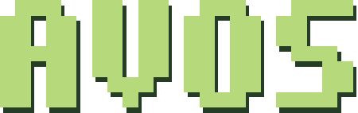
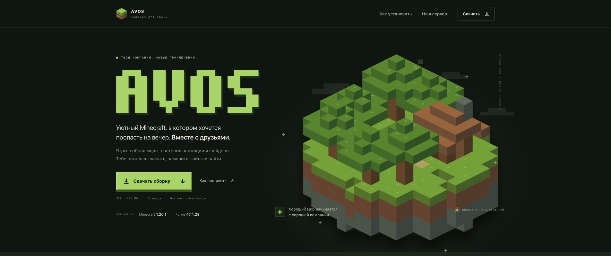
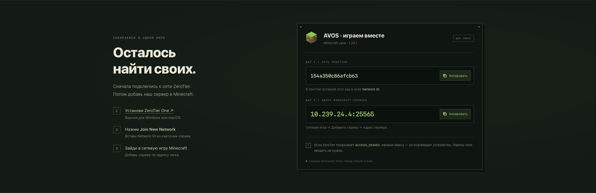

### Знакомый Minecraft. Больше жизни. Вся компания рядом.

Сборка для спокойного выживания, дальних вылазок и вечеров с друзьями.

**[Открыть сайт](https://mods-ot-maxa.vercel.app/) · [Скачать сборку](https://github.com/MaxVoicesDeveloper/minecraft-friends/releases/latest) · [Что внутри](#что-внутри) · [Установка](#установка) · [Авторы компонентов](CREDITS.md)**

> **Об авторстве.** Это сборка и настройка готовых модов для игры с друзьями. **Я не разрабатывал входящие в неё моды, шейдеры и ресурспаки и не выдаю их за свои.** Название «Моды от Макса» обозначает подборку от Макса. Все права на компоненты принадлежат их авторам. Спасибо им за работу!

## Встречаемся в нашем мире

Скриншоты страницы сборки. Иллюстрация на обложке — оформление сайта, не игровой кадр.

<b>Как выглядит подключение — адреса под рукой</b>

## Что внутри

| Для чего | Что добавлено |
| --- | --- |
| 🌲 Исследовать мир | Terralith, смена сезонов Serene Seasons, приключения Blue Skies |
| 🪓 Обживать лес | Profet’s Timber с анимированным падением деревьев |
| 🍳 Готовить и выживать | Farmer’s Delight, Kaleidoscope Cookery и Immersive Eating |
| 🧭 Не терять друзей | Мини-карта, карта мира Xaero и временные метки Ping Wheel |
| 🐑 Оживить привычное | Fresh Animations, FirstPerson, Mo’ Bends и Not Enough Animations |
| 🌧️ Почувствовать атмосферу | AmbientSounds, Presence Footsteps, Sound Physics Remastered и Weather Glass |
| 🏡 Устроить привал | Мебель Handcrafted, Comforts, находки Artifacts и задания Bountiful |
| ✨ Настроить картинку | Oculus, динамический свет и шейдеры; Embeddium, FerriteCore и ModernFix |

Русский язык и настройки входят в клиентский архив. Отдельные строки сторонних модов могут оставаться на английском. Производительность зависит от компьютера и выбранных шейдеров.

## Установка

1. Установи **Minecraft 1.20.1 с Forge 47.4.29**. Для запуска нужна **Java 17**. Удобнее создать отдельный профиль сборки в лаунчере.
2. Открой [последний выпуск](https://github.com/MaxVoicesDeveloper/minecraft-friends/releases/latest) и скачай **`max-friends-1.20.1.zip`** — около **205 МБ**. `Source code` — это исходники страницы, не модпак.
3. Закрой Minecraft. Открой папку игры именно этого профиля. Сохрани резервную копию своих настроек.
4. Удали старую папку `mods` из профиля и перенеси содержимое ZIP в папку игры с заменой файлов. Архив раскрывается прямо в `mods`, `config`, `resourcepacks`, `shaderpacks` и другие файлы профиля. **Папку `saves` с мирами не удаляй.**
5. Запусти профиль **Forge 1.20.1** и дождись главного меню.

**Где папка игры?** В лаунчере открой настройки профиля → «Папка игры». Это надёжнее, чем искать общий каталог: разные профили могут храниться отдельно.

## Подключение к друзьям

| Что | Значение |
| --- | --- |
| ZeroTier Network ID | `154a350c86afcb63` |
| Адрес Minecraft-сервера | `10.239.24.4:25565` |
| Версия | Minecraft 1.20.1 · Forge |

1. Установи [ZeroTier](https://www.zerotier.com/download/) и выбери **Join New Network**.
2. Вставь Network ID из таблицы. Это идентификатор сети, не пароль.
3. Если сеть ожидает разрешения / показывает `ACCESS_DENIED`, напиши Максу: он должен разрешить твоё устройство.
4. Когда сервер запущен, в Minecraft открой **«Сетевая игра» → «Добавить сервер»** и вставь адрес из таблицы.

Игровой сервер запускается отдельно: доступность сайта и архива не означает, что сервер сейчас работает.

## Пара полезных привычек

- Используйте одну и ту же версию архива: при обновлении сборки обновляйтесь всей компанией.
- Карта мира открывается на **M**. Привязки остальных действий можно посмотреть и изменить в настройках управления.
- Если FPS мало, сначала выключите шейдеры и уменьшите дальность прорисовки.
- Новые особенности генерации мира появляются в новых чанках.

## Авторы и благодарности

**Макс / [MaxVoicesDeveloper](https://github.com/MaxVoicesDeveloper)** — подбор компонентов, конфигурация и организация игры с друзьями.

**Разработчики модов, шейдеров и ресурспаков** — авторы соответствующих компонентов. Перечень с именами, ссылками и лицензиями находится в **[CREDITS.md](CREDITS.md)**. Лицензия страницы не заменяет лицензии включённых компонентов.

Неофициальная сборка для Minecraft. Не связана с Mojang Studios или Microsoft и не одобрена ими.
